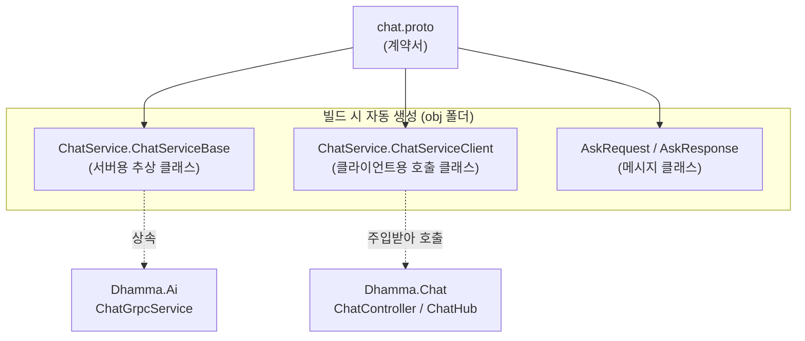
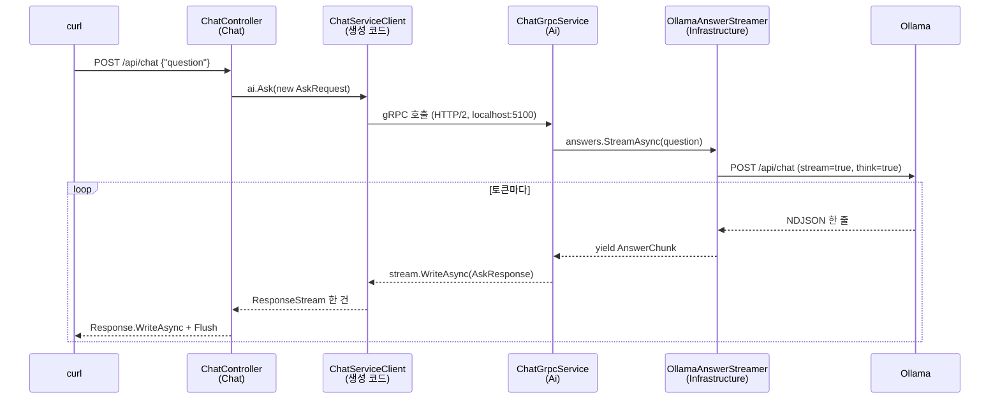

# Dhamma

## 구성

- 의존 방향
- Chat -> Infrastructure -> Core
- Chat 과 Infrastructure 가 Contracts 를 참조


```bash
dhamma/
├─ Dhamma.slnx
├─ Directory.Build.props      # net10.0, Nullable, 경고를 오류로
├─ Directory.Packages.props   # 패키지 버전 중앙 관리
├─ src/
│  ├─ Dhamma.Contracts/       # .proto (gRPC 계약)
│  ├─ Dhamma.Core/            # 순혈: 엔티티, 상태 전이, 포트(인터페이스), 대화 오케스트레이션
│  ├─ Dhamma.Infrastructure/  # 궂은일: EF Core + 마이그레이션, gRPC 클라이언트, Redis
│  ├─ Dhamma.Chat/            # 호스트(기존 Api 자리): SignalR Hub, JWT, 조립
│  └─ Dhamma.Ai/              # 호스트: gRPC 서버, Ollama 호출, 페르소나
├─ tests/
│  └─ Dhamma.Core.Tests/
└─ deploy/                    # k8s, nginx, sql, scripts


```


## 배포 설계

1. ship.sh: Mac에서 rsync로 /home/dharma/Dhamma/source에 소스를 보냅니다.
2. build.sh: 서버에서 dhamma-chat과 dhamma-ai를 빌드하고 k3s에 import합니다.
3. 배포: kubectl set image 후 rollout status를 확인합니다.
4. 비밀값(DB 연결 문자열, JWT 키)은 이미지나 저장소에 넣지 않고 스크립트가 K8s Secret으로 만듭니다.


## 테스트

```bash

# terminal 1
dotnet run --project src/Dhamma.Ai/Dhamma.Ai.csproj
# terminal 2
dotnet run --project src/Dhamma.Chat/Dhamma.Chat.csproj


# 1. 최초 질문
curl -N -X POST "http://localhost:5186/api/chat?thinking=true" \
  -H "Content-Type: application/json" \
  -d '{"question":"색즉시공에 대하여 설명 부탁해"}'

# 2. 이력 포함
curl -N -X POST "http://localhost:5186/api/chat" \
  -H "Content-Type: application/json" \
  -d '{
    "question": "방금 설명한 내용을 한 줄로 요약해줘",
    "history": [
      {"role": "user", "content": "색즉시공에 대하여 설명 부탁해"},
      {"role": "assistant", "content": "색즉시공은 형상이 곧 공이라는 뜻으로, 모든 현상에 고정된 실체가 없음을 말합니다."}
    ]
  }'


# thinking 과정이 즉시 나온후 대답이 표현
# thinking = true
```

## Clear nuget

```bash
dotnet nuget locals all --clear
dotnet build


# 테스트
curl -N http://192.168.0.8:11434/api/chat -d '{                                                                                                          [입력]
  "model":"dhamma-chat:latest","stream":true,
  "messages":[{"role":"user","content":"색즉시공 설명"}]
}' | head -n 5


curl -N http://localhost:5186/api/chat -d '{                                                                                                          [입력]
  "model":"dhamma-chat:latest","stream":true,
  "messages":[{"role":"user","content":"색즉시공 설명"}]
}' | head -n 5

```

## 구조

```text
dhamma/
├─ Dhamma.slnx
├─ Directory.Build.props      # net10.0, Nullable, 경고를 오류로
├─ Directory.Packages.props   # 패키지 버전 중앙 관리
├─ src/
│  ├─ Dhamma.Contracts/       # .proto (gRPC 계약)
│  ├─ Dhamma.Core/            # 순혈: 엔티티, 상태 전이, 포트(인터페이스), 대화 오케스트레이션
│  ├─ Dhamma.Infrastructure/  # 궂은일: EF Core + 마이그레이션, gRPC 클라이언트, Redis
│  ├─ Dhamma.Chat/            # 호스트(기존 Api 자리): SignalR Hub, JWT, 조립
│  └─ Dhamma.Ai/              # 호스트: gRPC 서버, Ollama 호출, 페르소나
├─ tests/
│  └─ Dhamma.Core.Tests/
└─ deploy/                    # k8s, nginx, sql, scripts
```

---

## 솔루션 구조 상세

```text
Dhamma.slnx
src/
├─ Dhamma.Core/                  순수 도메인. 의존하는 프로젝트 없음
│   └─ Chat/IAnswerStreamer.cs
├─ Dhamma.Contracts/             .proto + 생성된 gRPC 코드 (서버/클라이언트 둘 다)
│   └─ Protos/
│       ├─ dhamma/ai/v1/chat.proto
│       └─ external/buddham/ai.proto
├─ Dhamma.Infrastructure/        바깥 세계와 말하는 구현체
│   └─ Ollama/
│       ├─ OllamaOptions.cs
│       └─ OllamaAnswerStreamer.cs
├─ Dhamma.Ai/                    gRPC 서버 호스트 (:5100)
│   ├─ Services/ChatGrpcService.cs
│   └─ Program.cs, appsettings.json
└─ Dhamma.Chat/                  API + SignalR 호스트 (:5200)
    ├─ Controllers/ChatController.cs
    ├─ Hubs/ChatHub.cs
    └─ Program.cs, appsettings.Development.json
```

---


## gRPC 와 함께 하는 흐름도 이해하기

### 핵심 아이디어: 한 장의 계약서, 두 개의 생성물

gRPC를 이해하는 열쇠는 이것 하나

> **`chat.proto`는 "계약서"이고, 빌드할 때 이 계약서로부터 C# 코드가 자동 생성된다.**
> 서버(Ai)는 생성된 `ChatServiceBase`를 **상속**하고, 클라이언트(Chat)는 생성된 `ChatServiceClient`를 **호출**한다.

즉, 직접 쓴 코드가 아니라서 소스 폴더에서 찾으면 보이지 않습니다. 그래서 코드 이해하는 과정에서 혼란이 오는 것입니다.



- 생성은 `Dhamma.Contracts` 프로젝트가 담당하고,
- Ai와 Chat이 이 프로젝트를 **참조**해서 같은 생성물을 공유합니다.
- 그래서 `chat.proto`에 `is_thinking`을 추가하고 재빌드해야 양쪽에 동시에 `IsThinking`이 생기는 것입니다.
- 재빌드 하지 않을때 찾지 못하는 오류 발생의 근원

## 프로세스 구성: 실행 중인 것은 3개

```text
[브라우저/curl]  →  [Dhamma.Chat :5186]  →  [Dhamma.Ai :5100]  →  [Ollama :11434]
   (손님)            (웨이터: HTTP/SignalR)    (주방장: gRPC 서버)     (오븐: LLM)
```

| 프로세스 | 프로토콜 | 역할 |
|---|---|---|
| Chat | 바깥쪽 HTTP / SignalR, 안쪽 gRPC **클라이언트** | 손님 응대, 주문 전달 |
| Ai | gRPC **서버** (HTTP/2) | 주문 받아 Ollama에 요청 |
| Ollama | HTTP + NDJSON | 실제 추론 |

## 호출 흐름: `POST /api/chat` 한 번의 여정



## 단계별로 코드와 매핑하기

**① Chat 진입점** (`ChatController.Ask`)
```csharp
using var call = ai.Ask(new AskRequest { Question = body.Question }, cancellationToken: ct);
```
`ai`는 `ChatServiceClient`입니다. `Program.cs`의 `AddGrpcClient<ChatService.ChatServiceClient>(... "http://localhost:5100")` 덕분에 DI가 주소까지 설정해서 넣어 줍니다. 이 한 줄이 네트워크를 타고 Ai로 날아갑니다.

**② Ai가 호출을 받음** (`ChatGrpcService.Ask`)
`Program_1.cs`의 `MapGrpcService<ChatGrpcService>()`가 "5100 포트로 들어오는 `ChatService.Ask` 호출은 이 클래스로 보내라"고 연결해 둔 곳입니다. `ChatServiceBase`를 상속하고 `Ask`를 `override`하는 것이 계약 이행입니다.

**③ Core의 포트를 통해 구현체 호출**
`ChatGrpcService`는 `IAnswerStreamer`(Core의 인터페이스)만 압니다. 실제로 누가 들어오는지는 `Program_1.cs`의 `AddScoped<IAnswerStreamer, OllamaAnswerStreamer>()`가 정합니다. 이것이 의존성 역전의 실체입니다.

**④ Ollama 호출** (`OllamaChatClient.StreamAsync`)
`HttpClient`로 `/api/chat`에 POST하고, 줄 단위 JSON을 읽을 때마다 `thinking`이면 `IsThinking: true`, `content`이면 `false`로 `AnswerChunk`를 `yield return`합니다.

**⑤ 역방향 전파**
`AnswerChunk` → `AskResponse`(gRPC 메시지) → Chat의 `ResponseStream` → `Response.WriteAsync`로 한 토큰씩 올라옵니다. 어느 구간도 전체 답변을 모아 두지 않기 때문에 실시간으로 보입니다.

## 참조 관계 지도 (누가 누구를 아는가)

```text
Dhamma.Core            ← 아무도 모름 (IAnswerStreamer, AnswerChunk)
   ↑
Dhamma.Infrastructure  → Core 참조 (OllamaAnswerStreamer가 IAnswerStreamer 구현)
   ↑
Dhamma.Ai              → Core, Infrastructure, Contracts 참조 (서버 호스트)
Dhamma.Chat            → Contracts 참조 (클라이언트 호스트)  ※ Core/Infra는 아직 안 씀
Dhamma.Contracts       → .proto만 있음 (생성 코드의 원천)
```

여기서 눈여겨볼 점은 **Chat은 Ai를 직접 참조하지 않는다**는 것입니다. 둘은 오직 Contracts(계약서)와 네트워크로만 연결됩니다. 그래서 Ai를 다른 서버나 다른 언어로 바꿔도 `chat.proto`만 지키면 Chat은 모릅니다.

## 데이터 변환 지도

한 토큰이 거치는 타입 변화입니다. 유지보수할 때 어느 층에서 어떤 타입인지 헷갈리면 이 표를 보세요.

| 구간 | 타입 |
|---|---|
| Ollama → Infrastructure | JSON 한 줄 (`message.thinking` / `message.content`) |
| Infrastructure → Ai | `AnswerChunk(Text, IsThinking)` (Core 타입) |
| Ai → Chat (네트워크) | `AskResponse { text, is_thinking }` (proto 생성 타입) |
| Chat → 클라이언트 | HTTP: 순수 텍스트 / SignalR: `ChatChunk` JSON |

타입이 층마다 달라지는 것은 **의도된 설계**입니다. 층마다 자기 언어를 쓰고 경계에서만 변환하기 때문에, Ollama를 다른 LLM으로 바꿔도 변경이 Infrastructure 한 곳에서 끝납니다.

## 유지보수 체크리스트: "무엇을 바꾸면 어디를 건드리나"

| 하고 싶은 일 | 건드릴 곳 |
|---|---|
| 응답에 필드 추가 (예: 토큰 수) | `chat.proto` → `AnswerChunk` → `OllamaChatClient` → `ChatGrpcService`(매핑) → Chat 쪽 사용처 |
| 다른 LLM으로 교체 | Infrastructure에 새 `IAnswerStreamer` 구현 + Ai의 `Program_1.cs` 등록 한 줄 |
| 시스템 프롬프트/모델 변경 | `Dhamma.Ai/appsettings.json`의 `Ollama` 섹션 (코드 수정 없음) |
| Ai 서버 주소 변경 | Chat의 `Program.cs` gRPC 주소 (아직 하드코딩) |
| 새 gRPC 메서드 추가 | `chat.proto`에 `rpc` 추가 → 빌드 → Ai는 `override`, Chat은 `ai.새메서드` 호출 |

## 문제가 생겼을 때 디버깅 순서

1. **`CS0117`/`CS1061`(멤버 없음)**: proto 수정 후 재빌드 안 함. Language Server 재시작.
2. **Chat에서 `Unavailable` 오류**: Ai가 안 떠 있거나 포트 불일치. `5100` 확인.
3. **Ai는 정상인데 응답이 비어 있음**: Ollama 쪽. README의 `curl http://192.168.0.8:11434/api/chat` 직접 호출로 Ollama 단독 확인.
4. **구간 나눠 확인하는 요령**: 뒤에서부터 확인하세요. Ollama 직접 curl → Ai 로그 → Chat curl 순서로 올라오면 어디서 끊겼는지 바로 보입니다.

## 한 줄 요약

> **proto가 계약서, 빌드가 코드 인쇄소, Ai는 계약을 이행하는 쪽(상속), Chat은 계약을 호출하는 쪽(주입).**
> 둘은 서로의 코드를 모르고 계약서와 네트워크로만 만난다.

---
